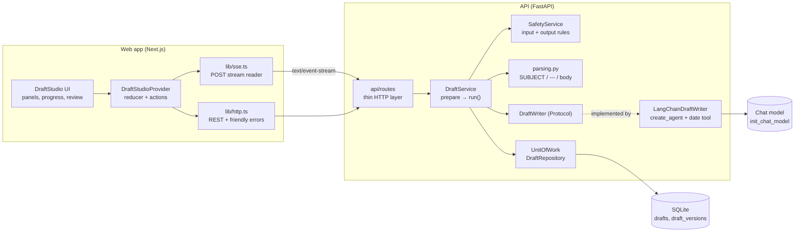
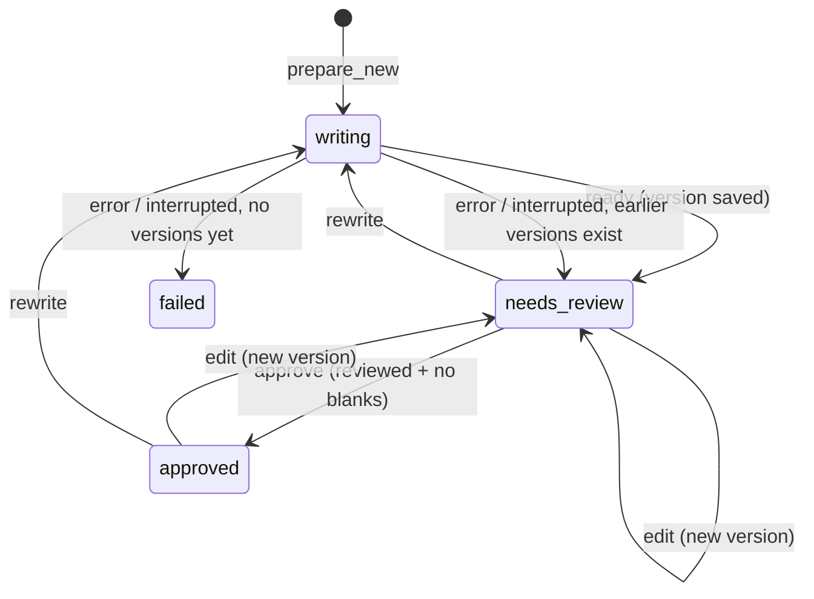

# Draftly

**Turn rough ideas into emails worth sending.** Describe what you need in a sentence; Draftly writes a clear,
polished draft while you watch, anchors every date to *your* today, checks the result for personal details,
blanks and tone, and waits for human review. An approved version can be saved to Gmail drafts or sent at a time the user explicitly schedules.

| | |
|---|---|
| **Backend** | FastAPI, LangChain agents, SQLAlchemy async, Alembic, SQLite/PostgreSQL, Redis/Celery, SSE |
| **Frontend** | Next.js 16 (App Router) · React 19 · TypeScript (strict) · Tailwind CSS v4 · TanStack Query |
| **Model** | Any tool-calling chat model `init_chat_model` supports. Default `ollama:gemma4:31b-cloud` |
| **Principles** | Human in the loop · honest, event-driven progress · safety checks on input and output · plain language UI |

---

## Contents

1. [Quick start](#1-quick-start)
2. [Architecture](#2-architecture)
3. [The AI flow, technically](#3-the-ai-flow-technically)
4. [API reference](#4-api-reference)
5. [Configuration](#5-configuration)
6. [Project structure](#6-project-structure)
7. [Testing and quality](#7-testing-and-quality)
8. [Extending Draftly](#8-extending-draftly)
9. [Guide for AI coding assistants](#9-guide-for-ai-coding-assistants)
10. [Troubleshooting](#10-troubleshooting)

---

## 1. Quick start

**Requirements:** Python 3.12+, [uv](https://docs.astral.sh/uv/), Node 20+, Redis for background scheduling, and a chat model with tool calling. The default runs through a local [Ollama](https://ollama.com).

```bash
# Terminal 1: API on http://localhost:8000
cd api
uv sync
# Keep an existing .env; add DRAFTLY_SUPER_ADMIN_EMAIL and Google settings there.
uv run python -m app.cli bootstrap-admin  # one time, prompts for the admin password
uv run uvicorn app.main:app --reload

# Terminal 2: web app on http://localhost:3000
cd web
npm install
npm run dev
```

For scheduled delivery during local development, run Redis plus a Celery worker and beat process in two more terminals. The worker and scheduler commands are listed below.

Pick the model in `api/.env`:

```bash
DRAFTLY_LLM_MODEL=ollama:gemma4:31b-cloud   # default (Ollama cloud model, needs Ollama sign-in/quota)
DRAFTLY_LLM_MODEL=ollama:llama3.1:8b        # fully local alternative
```

Docker: `docker compose up --build` (the API reaches Ollama on the host through `host.docker.internal`).

---

## 2. Architecture



**Layering rule:** every layer only calls the one below it. Routes never touch the database; services never
import LangChain. The service depends on the `DraftWriter` protocol, so the model can be swapped and tests run
with a `FakeWriter`.

---

## 3. The AI flow, technically

### 3.1 One request, end to end

```mermaid
sequenceDiagram
  autonumber
  participant B as Browser
  participant R as Route /api/drafts/stream
  participant S as DraftService
  participant W as LangChainDraftWriter
  participant A as Agent (LangGraph)
  participant M as Chat model
  participant T as get_today tool
  participant D as SQLite

  B->>R: POST {idea, kind, tone, length, time_zone}
  R->>S: prepare_new(request)
  S->>S: SafetyService.check_idea(idea)
  alt harmful idea
    S-->>B: 422 {error: blocked_idea} (before any streaming)
  end
  S->>D: insert Draft(status=writing), commit
  R-->>B: 200 text/event-stream
  S-->>B: started{draft_id}, step understand active→done, step date_check active
  S->>W: stream(WriteJob)
  W->>A: create_agent(model, tools=[get_today bound to time zone], system_prompt)
  A->>M: system + user prompt
  M-->>A: tool call get_today (any text before it is dropped)
  A->>T: invoke
  T-->>A: "Today is Tuesday, 20 October 2026 (Asia/Karachi)."
  S-->>B: reset (if chatter), date{value}, step date_check done
  A->>M: messages + tool result
  loop token chunks
    M-->>A: text delta
    S-->>B: step writing active (first time), token{text}
  end
  S-->>B: step writing done, step checking active
  S->>S: parse_draft → (subject, body); check_draft → 4 rule results
  S->>D: add DraftVersion, status=needs_review, commit
  S-->>B: step checking done, step review active, ready{draft}
```

### 3.2 Building the agent

`api/app/agents/langchain_writer.py`

```python
self._model = init_chat_model(settings.llm_model, temperature=..., base_url=...)   # once, at startup

agent = create_agent(                                   # per request
    model=self._model,
    tools=[make_date_tool(job.time_zone)],              # closure: "today" in the person's zone
    system_prompt=SYSTEM_PROMPT,
)
agent.astream({"messages": [{"role": "user", "content": build_user_prompt(job)}]}, stream_mode="messages")
```

- `init_chat_model` takes a `provider:model` string (`ollama:llama3.1:8b`, `anthropic:...`, `openai:...`), so
  switching providers is configuration, not code (install the provider's LangChain package).
- The agent is built **per request** because the date tool is a closure over the person's IANA time zone
  (`safe_zone()` falls back to UTC for unknown zones). "Tomorrow" is therefore the person's tomorrow.
- `create_agent` runs the LangGraph loop: `model` node → (tool calls?) → `tools` node → `model` node → … until
  the model answers without a tool call.

### 3.3 From LangGraph stream to writer events

`stream_mode="messages"` yields `(message_chunk, metadata)` pairs (some versions wrap them as
`{"type": "messages", "data": (...)}`; `_unpack` accepts both). Mapping, in `_to_events`:

| `metadata["langgraph_node"]` | What arrives | Writer event |
|---|---|---|
| `model` | `AIMessageChunk.tool_call_chunks[i].name` set | `ToolCalled(name)` |
| `model` | `content` as `str` or a list of `{"type": "text"}` blocks | `TextDelta(text)` |
| `tools` | `ToolMessage` | `ToolReturned(name, output)` |

**Timeout:** a single deadline (`DRAFTLY_LLM_TIMEOUT_SECONDS`) wraps each `anext()` with
`asyncio.timeout_at`, so only time spent *waiting on the model* counts, never the consumer's own work. The
iterator is always closed in `finally`.

### 3.4 From writer events to stream events

`DraftService._run()` turns writer events into the public event protocol and drives the progress steps from
real events (no timers pretend to be progress; `step_pacing_seconds` only spaces out instant steps):

| Writer event | Service reaction |
|---|---|
| `ToolCalled` with text already buffered | clear buffer, emit **`reset`** (pre-tool chatter must not leak into the email) |
| `ToolReturned(get_today)` | emit **`date{value}`** + `step date_check done` |
| first `TextDelta` | emit `step writing active` |
| every `TextDelta` | append to buffer, emit **`token{text}`** |
| stream ends, no date seen | **fallback:** emit the server's date for the person's zone (the model skipped the tool) |
| stream ends | `writing done` → `checking active` → parse → safety rules → persist → `checking done` → `review active` → **`ready{draft}`** |

Every run ends with exactly one `ready` or `error` event, unless the client disconnects.

### 3.5 Prompt design

`api/app/agents/prompts.py`

- **Fixed output contract:** `SUBJECT: …` / `---` / body. Nothing else, no markdown.
- **Tool first:** the system prompt requires calling `get_today` before writing.
- **Injection boundary:** the person's text is wrapped in `<idea>`, `<previous>` and `<instructions>` tags
  and declared as material, never as rules. Instructions may only shape the email's content and style.
- **No invented facts:** missing names, times, prices or links become square-bracket placeholders
  (`[Recipient name]`, `[Time]`), which the UI highlights and the approval guard enforces.
- **Rewrites** include the previous version and ask for a clearly different structure with the same facts;
  optional tone, length and free-text instructions are applied.

### 3.6 Parsing (server and live preview)

Models drift from formats, so `services/parsing.py` tolerates `**Subject:** x`, `## Subject: x`, code fences,
`***` separators, a `Body:` label and `**bold**`. `web/src/features/drafts/parse.ts` mirrors it exactly so the
live preview matches what gets saved; `parsePartial()` additionally hides a half-streamed `SUBJ…` label so the
preview never flickers.

### 3.7 Safety

| Stage | Where | Behaviour |
|---|---|---|
| **Input** | `SafetyService.check_idea` | Phishing, malware, threats, harassment and scam patterns → `422 blocked_idea` **before** a stream or row exists. Also applied to rewrite instructions. |
| **Output** | `SafetyService.check_draft` | Four rule objects `{key, label, passed, message}`: *Subject line*, *Blanks to fill*, *Personal details* (emails, phones, card numbers, password mentions), *Respectful language* (hostile wording, shouting). |
| **While editing** | `POST /api/safety/check` | The web app re-runs the output rules 350 ms after the person stops typing. |
| **Approval** | `DraftService.approve` | Requires `reviewed: true` (422 otherwise) and refuses while blanks remain (409 `blanks_left`). |

### 3.8 Draft lifecycle and persistence



- **Versions** are append-only (`written`, `rewrite`, `edited`); an edit with identical text adds nothing.
- **Unit of work per step:** each step opens a short session (`UnitOfWork`) and commits; no session is held
  across a stream. `expire_on_commit=False` lets the service map rows after commit.
- **Conflicts:** edit, rewrite or approve while `writing` → `409 still_writing`.

### 3.9 Cancellation and failures

- The client stops a run by aborting the fetch. Starlette cancels the response, the service catches
  `CancelledError`/`GeneratorExit`, runs `asyncio.shield(_interrupt())` to reset the status, and re-raises.
- Any other exception is logged and becomes a friendly `error{message}`: timeout → *"took too long"*,
  HTTP 429 → *"busy right now"*, connection errors → *"couldn't reach its writing service"*. Raw errors never
  reach the browser.
- The web app discards a brand-new draft that never reached `ready`, so History holds only real drafts.

### 3.10 How the web app consumes it

- `lib/sse.ts` POSTs JSON and reads `text/event-stream` with `TextDecoderStream`, splitting on blank lines.
  On abort it cancels the reader itself (a piped stream doesn't always see the abort).
- `features/drafts/state.ts` is one reducer: `phase` (`idle | writing | review | approved`), step states,
  `streamText`, `date`, the draft, the edit buffer and checks. `token` appends, `reset` clears, `ready` loads
  the draft.
- `DraftStudioProvider.tsx` owns the `AbortController`, actions (generate, stop, rewrite, edit, approve,
  discard, open), debounced live checks, and invalidates the React Query history after every run or change.

---

## 4. API reference

Errors are always `{"error": {"code", "message"}}`, and `message` is written for the person using the app.

| Method | Path | Body | Result |
|---|---|---|---|
| `POST` | `/api/drafts/stream` | `{idea, kind?, tone?, length?, time_zone?}` | event stream · `422 blocked_idea` / `invalid_request` |
| `POST` | `/api/drafts/{id}/rewrite/stream` | `{instructions?, tone?, length?}` | event stream · `404`, `409 still_writing`, `422` |
| `GET` | `/api/drafts?limit=30` | | `DraftSummary[]` |
| `GET` | `/api/drafts/stats` | | `{total, needs_review, approved}` |
| `GET` | `/api/drafts/{id}` | | `DraftOut` (versions + current checks + blanks) |
| `PUT` | `/api/drafts/{id}` | `{subject, body}` | `DraftOut`, new `edited` version, back to review |
| `POST` | `/api/drafts/{id}/approve` | `{reviewed: true}` | `DraftOut` · `422 not_reviewed`, `409 blanks_left`/`already_approved` |
| `DELETE` | `/api/drafts/{id}` | | `204` |
| `POST` | `/api/safety/check` | `{subject, body}` | `{checks, blanks}` |
| `GET` | `/api/connectors` | | Gmail / Outlook (`coming_soon`) |
| `GET` | `/api/health` | | `{status: "ok"}` |

Enums: `kind` = `new | reply | follow_up` · `tone` = `professional | friendly | direct | warm` ·
`length` = `short | medium | long`.

**Stream events** (one JSON object per `data:` line):

| Event | Payload | Meaning |
|---|---|---|
| `started` | `draft_id` | Draft row exists |
| `step` | `step`, `state` (`active`/`done`) | `understand → date_check → writing → checking → review` |
| `date` | `value` | Today in the person's time zone |
| `token` | `text` | Next piece of the email |
| `reset` | | Drop everything streamed so far |
| `ready` | `draft` (`DraftOut`) | Saved and waiting for review |
| `error` | `message` | Friendly failure; the run is over |

```bash
curl -N -X POST localhost:8000/api/drafts/stream -H 'Content-Type: application/json' \
  -d '{"idea":"ask Sara to move our sync to tomorrow","tone":"friendly","time_zone":"Asia/Karachi"}'
```

Interactive docs: http://localhost:8000/docs

---

## 5. Configuration

API settings use the `DRAFTLY_` prefix (environment or `api/.env`):

| Variable | Default | Purpose |
|---|---|---|
| `DRAFTLY_LLM_MODEL` | `ollama:gemma4:31b-cloud` | `provider:model` for `init_chat_model` |
| `DRAFTLY_LLM_BASE_URL` | unset | Custom endpoint, e.g. a remote Ollama |
| `DRAFTLY_LLM_TEMPERATURE` | `0.6` | Sampling temperature |
| `DRAFTLY_LLM_TIMEOUT_SECONDS` | `120` | Total time allowed waiting on the model per run |
| `DRAFTLY_STEP_PACING_SECONDS` | `0.35` | Pause between instant steps so progress is readable (`0` in tests) |
| `DRAFTLY_DATABASE_URL` | `sqlite+aiosqlite:///./draftly.db` | SQLAlchemy async URL |
| `DRAFTLY_CORS_ORIGINS` | `["http://localhost:3000","http://127.0.0.1:3000"]` | JSON list |
| `DRAFTLY_LOG_LEVEL` | `INFO` | |
| `DRAFTLY_EMAIL_VERIFICATION_SECRET` | unset | Random secret of at least 32 characters for hashing signup codes |
| `DRAFTLY_EMAIL_SMTP_HOST` | unset | SMTP server used to deliver account verification codes |
| `DRAFTLY_EMAIL_SMTP_PORT` | `587` | SMTP port; port 587 uses STARTTLS |
| `DRAFTLY_EMAIL_SMTP_USERNAME` / `DRAFTLY_EMAIL_SMTP_PASSWORD` | unset | SMTP login, if required by the provider |
| `DRAFTLY_EMAIL_SMTP_FROM` | unset | Verified sender address shown on signup messages |
| `DRAFTLY_EMAIL_SMTP_USE_SSL` | `false` | Use implicit TLS (commonly port 465) instead of STARTTLS |

Web: `NEXT_PUBLIC_API_URL` (default `http://localhost:8000`).

---

## 6. Project structure

```
api/app
  main.py              create_app(settings, writer) factory, lifespan wires services; `app` for fastapi dev
  core/                config, logging, DomainError → JSON error responses
  domain/              StrEnums (type, tone, length, status, version source, step), time-zone helpers
  models/ db/          Draft + DraftVersion (SQLAlchemy 2 async), engine/session factory
  repositories/        DraftRepository, UnitOfWork
  agents/              contracts.py (WriteJob, writer events, DraftWriter), langchain_writer.py, prompts.py, tools.py
  services/            draft_service.py, safety.py, parsing.py, mappers.py
  schemas/             request/response models, stream events
  api/                 routes (drafts, safety, meta), sse.py, deps.py
  integrations/        MailProvider protocol + connector registry
api/tests              FakeWriter, stream/review/check tests

web/src
  app/                 layout, page, globals.css (theme tokens, animations), icon.svg
  components/ui        Button, Card, Pill, Segmented, Spinner, StopIndicator, icons
  components/layout    AppHeader, Logo, ThemeToggle, BrandOutline (animated wordmark)
  features/drafts      types.ts, constants.ts (all UI copy), api.ts, parse.ts, state.ts, DraftStudioProvider.tsx
  features/drafts/components
                       DraftStudio, IdeaPanel, DraftWorkspace, ProgressSteps, ReviewPanel, SafetyPanel,
                       HistoryPanel, StatsBar, HowItWorks, ComingSoonPanel
  lib/                 http.ts, sse.ts, format.ts, cx.ts
```

---

## 7. Testing and quality

```bash
cd api && uv run pytest -q && uv run ruff check app tests     # 22 tests, ruff line length 110
cd web && npx tsc --noEmit && npx next build
```

Tests never call a model. `tests/conftest.py` provides a `FakeWriter` that behaves like the agent: chatter, a
`get_today` tool call and result, then the email in small chunks. The app is built with
`create_app(settings, writer=FakeWriter())` and driven through `httpx.ASGITransport` inside the app's lifespan.
Covered: event order and steps, `reset`, date fallback, unknown time zones, blocked input, empty output,
writer crashes, edit → rewrite → approve, blanks guard, conflicts, discard/404, interrupted runs, safety rules
and the parser.

---

## 8. Extending Draftly

**Use another model.** Set `DRAFTLY_LLM_MODEL` (e.g. `anthropic:<model>` or `openai:<model>`) and add the
provider package (`uv add langchain-anthropic`). The model must support tool calling.

**Add a tool.** Create it in `agents/tools.py` (bind per-request context through a closure, as
`make_date_tool` does), pass it to `create_agent`, mention it in `SYSTEM_PROMPT`, and decide in
`DraftService._run` whether its `ToolReturned` should emit a stream event or move a step.

**Add a safety rule.** Return another `CheckResult` from `SafetyService.check_draft`; the UI renders any rule
it receives. Blocking input patterns live in `_BLOCKED_IDEAS`.

**Add a mail connector.** Implement `MailProvider.save_draft` in `integrations/`, register it in `CONNECTORS`
with `status="available"`, and call it only from an explicit, approved action. Never send automatically.

**Swap the writer entirely.** Implement `DraftWriter.stream(job) -> AsyncIterator[ToolCalled | ToolReturned |
TextDelta]` and pass it to `create_app(writer=...)`. Nothing else changes.

---

## 9. Guide for AI coding assistants

Read this before changing the code. These rules are product requirements, not style preferences.

1. **Human in the loop.** Nothing is sent or published automatically. Approval needs `reviewed: true`. Any
   edit or rewrite returns a draft to review.
2. **Plain language in the UI.** Never show technical names to the person: no LangChain, Ollama, model,
   agent, tool, prompt, token, MCP. Use "Draftly", "Date check", "Safety checks", "Blanks to fill",
   "You're in control". All UI copy lives in `web/src/features/drafts/constants.ts`; API error messages are
   user-facing too.
3. **Honest progress.** Steps move only on real server events. Don't add timers that fake progress.
4. **Layering.** Routes → services → repositories/writer. Services never import LangChain. Keep a short
   `UnitOfWork` per step; never hold a session across a stream.
5. **Prepare, then stream.** Validate and persist in `prepare_*` so errors are proper HTTP responses; `run()`
   must always end with `ready` or `error`.
6. **Keep the parser mirrored.** Change `services/parsing.py` and `web/.../parse.ts` together.
7. **Event protocol is a contract.** Changing an event means updating `schemas/events.py`,
   `web/.../types.ts` and the reducer in `state.ts`.
8. **Tests use `FakeWriter`.** Don't make tests call a real model. Add a test for every behaviour change.
9. **Verify before handing over:** `pytest`, `ruff`, `tsc --noEmit`, `next build`, then drive the UI
   (idea → Write my draft → review → edit → approve) in dark and light themes and at 390 px width.

Known pitfalls:

- Model text before a tool call leaks into the email unless you emit `reset` and clear the buffer.
- `next/font/google` fails offline; fonts come from the `geist` package.
- Kill an old `next-server` before `next start` after a rebuild, or the page loads stale chunks.
- In Tailwind v4, a variant class can lose to a component's base class; use the `!` suffix (`border-accent!`)
  when overriding `Button`/`Card` styles.
- React reuses a DOM button across a conditional swap; give swapped action buttons distinct `key`s so a click
  on Stop can never land on a submit button.

---

## 10. Troubleshooting

| Symptom | Cause and fix |
|---|---|
| "Draftly is busy right now" | The model provider returned 429 (e.g. Ollama cloud quota). Wait, or switch to a local model such as `ollama:llama3.1:8b`. |
| "Draftly couldn't reach its writing service" | Ollama isn't running or `DRAFTLY_LLM_BASE_URL` is wrong. Check `curl localhost:11434/api/tags`. |
| "We can't reach Draftly right now" (in the web app) | The API isn't running on `NEXT_PUBLIC_API_URL`, or CORS doesn't list the web origin. |
| Draft has no date or wrong day | Check the browser time zone; unknown zones fall back to UTC. |
| Port already in use | `lsof -ti:8000 \| xargs kill` (or `:3000`). |


## Draftly 2.0 accounts, Gmail and scheduling

The first user is not elevated automatically. Set `DRAFTLY_SUPER_ADMIN_EMAIL` in `api/.env`, start the API once to apply migrations, then run this command from `api/`:

```powershell
uv run python -m app.cli bootstrap-admin
```

It prompts for the password, creates the Super Admin only when none exists, and assigns pre-account drafts to that account without deleting their versions. New users provide a name, verify an email code, then choose a password; verified accounts can sign in immediately. Older pending signups can use the same email verification flow to activate their account.

Configure the SMTP settings above in the private `api/.env` file before enabling signup. Verification codes expire after 10 minutes, are rate limited, and are never returned by the API. The code must be verified before the password form is unlocked. For Compose, set the same `DRAFTLY_EMAIL_*` variables in the root `.env` file.

An operator can recover a user's account from the API host with `uv run python -m app.cli reset-user-password person@example.com`. The command prompts for a new password and revokes that user's existing sessions; it does not send email.

Alembic migrations run on API startup. Existing SQLite databases are backed up to `draftly.db.pre-draftly-v1.bak` before migration. The migration preserves existing drafts and versions; downgrade intentionally does not delete user data. Docker Compose uses PostgreSQL and Redis for production-oriented persistence and runs the API, worker, and scheduler. It keeps an existing `draftly-data` volume mounted read-only at `/legacy-data`; it does not silently import or remove it.

To copy SQLite records into an empty PostgreSQL database after starting Compose:

```powershell
docker compose exec api uv run python -m app.cli copy-sqlite-to-postgres --source sqlite+aiosqlite:////legacy-data/draftly.db
```

Copy the SQLite database before bootstrapping an administrator in the target PostgreSQL database. The command makes a temporary working copy, upgrades that copy, refuses a non-empty target, and leaves the original SQLite source unchanged. Back up PostgreSQL with `pg_dump` and test restore procedures before production use.

### Google OAuth

1. Enable the Gmail API in Google Cloud Console and configure the OAuth consent screen.
2. Create an OAuth Web application client and add the exact redirect URI from `DRAFTLY_GOOGLE_REDIRECT_URI` (local default: `http://localhost:8000/api/gmail/callback`).
3. Set `DRAFTLY_GOOGLE_CLIENT_ID` and `DRAFTLY_GOOGLE_CLIENT_SECRET`. Generate a Fernet key with `uv run python -c "from cryptography.fernet import Fernet; print(Fernet.generate_key().decode())"` and set it as `DRAFTLY_GMAIL_TOKEN_KEY`.
4. Connect from `/dashboard/integrations`. Draftly validates OAuth state and PKCE and encrypts refresh tokens at rest.

Set `DRAFTLY_COOKIE_SECURE=true` behind HTTPS, restrict CORS to the deployed web origin, and keep all secrets outside source control. Schedule times are stored as UTC and displayed in the browser's local timezone. Celery Beat checks for due sends every 15 seconds. A Gmail `sent` result means Gmail accepted the request; it does not confirm recipient delivery. Uncertain network outcomes are surfaced for review rather than blindly resent.

Added settings: `DRAFTLY_REDIS_URL`, `DRAFTLY_FRONTEND_URL`, `DRAFTLY_REGISTRATION_OPEN`, `DRAFTLY_COOKIE_SECURE`, `DRAFTLY_SUPER_ADMIN_EMAIL`, `DRAFTLY_GOOGLE_CLIENT_ID`, `DRAFTLY_GOOGLE_CLIENT_SECRET`, `DRAFTLY_GOOGLE_REDIRECT_URI`, `DRAFTLY_GMAIL_TOKEN_KEY`, `DRAFTLY_EMAIL_*`, and Compose's `POSTGRES_PASSWORD`.

### Local scheduled email delivery

When running the API locally, also run the email scheduler from a second terminal in the api directory: `uv run python -m app.worker`. Keep that terminal running for scheduled sends. It checks every 15 seconds and processes overdue approved emails using the same delivery safeguards as the Celery worker. Redis is not required for this local runner. Docker Compose already runs the worker and scheduler services.

